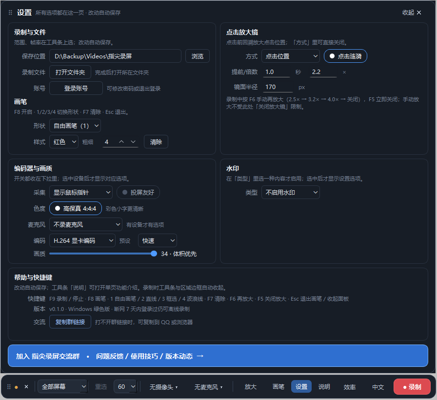

# 星点录屏

一款免费、闭源的 Windows 桌面录屏工具。原生分辨率高清录制、HEVC 高压缩小文件，**点击前 1 秒自动放大点击位置**——讲解操作时不用事后二次剪辑。

> 本软件是**免费但闭源**的专有软件，不是开源项目。本仓库只提供可执行文件与许可 / 说明文档，**不包含源代码，也不采用任何开源许可证**。使用条款见 `EULA.txt`。

## 主要特点

- **高清**：全屏按物理像素 1:1 抓取，DXGI 桌面复制优先，15 / 24 / 30 / 60 fps 可选；默认 CRF 20 保留文字细线，可选 4:4:4 高保真。
- **比例取景框**：先在设置里勾选「启用取景框」才生效（关闭时按原来的录制范围录、取景设置不生效）。内置 16:9 / 4:3 / 3:4 / 1:1 / 9:16 / 2.35:1 等比例（下拉带样式示意图），拖动设定大小后录制时取景框跟随鼠标移动——鼠标恒在画面中央、框外不录；也可拖动框放到屏幕任意位置。
- **文件小**：默认 `libx265`（HEVC）编码，静止画面重复帧几乎不占体积；有 N 卡可选硬件编码。
- **点击前 1 秒放大镜**：1 秒环形缓冲 + 延迟编码，在点击发生前就把点击位置渐入放大、点击瞬间涟漪标记，无需后期转码。三种方式可切换，也能全程跟随鼠标。
- **8 种界面语言**：简体中文 / English / 繁體中文 / 日本語 / 한국어 / Español / Français / Deutsch，即时切换并记住选择。
- **画笔与标注**：录制中 `F8` 开启画笔，自由画笔 / 直线 / 框选 / 波浪线随时切换，笔画一起录进视频。
- **效率工具**：`F10` 暂停 / 继续、`F11` 截图、开录倒计时、定时开录、最长时长、导出 GIF、鼠标点击高亮、屏幕按键显示、录制悬浮控制条、录完复制路径。
- **水印与画中画**：文字 / 时间 / 用户名 / 随机码 / 图片水印，多种显示方式；摄像头画中画与麦克风录音可选。
- **单页界面**：工具条、设置、功能介绍是三个可独立拖动的窗口，一次显示全部、不分页、无滚动条。

## 下载与安装

前往 **Releases** 下载 `星点录屏_安装版.exe`（约 150 MB），双击运行安装向导：

- 默认安装到 `D:\星点录屏`，**不会装进 `C:\Program Files`**，不需要管理员权限；
- 自动创建桌面图标、开始菜单项与卸载入口；
- 首次启动若被 Windows SmartScreen 或杀毒软件拦截（程序未做数字签名），点「更多信息 → 仍要运行」；
- 适用 **Windows 10 / 11 64 位**。

安装目录里会同时放入 `使用说明.txt` 和许可文档。Releases 中的 `EULA.txt`、`THIRD_PARTY_NOTICES.txt`、`COPYING.*.txt` 是法律文本，不是运行依赖；单独下载 exe 也能正常使用。

## 开始使用

1. 从桌面图标启动，工具条出现在屏幕底部居中。
2. 首次使用在「设置 → 录制与文件 → 账号」注册并登录（录制前需校验账号；断网时最近 7 天内登录过的设备可离线录制）。
3. 按 `F9` 开始 / 停止录制。视频默认保存到「此电脑 → 视频 → 星点录屏」，结束后会自动打开所在文件夹。

常用快捷键：

| 键 | 作用 |
| --- | --- |
| `F9` | 开始 / 停止录制 |
| `F10` | 暂停 / 继续 |
| `F11` | 截取当前录制范围 |
| `F8` | 录制中切换画笔，`1`~`4` 切换形状，`F7` 清除，`Esc` 退出 |
| `F6` / `F5` | 手动再放大 / 关闭手动放大 |

完整说明见 `使用说明.txt`。

## 许可与第三方组件

- 本软件按 `EULA.txt` 授权：可免费用于个人或商业目的，但不得反编译、修改、再分发或声称为开源项目。未授予任何开源许可证。
- 可执行文件内包含第三方组件，各自按原许可证授权，**不受 EULA 约束**。其中 FFmpeg 9.0.2 以 GNU GPL v3 授权，OpenCV 随附的 FFmpeg DLL 以 LGPL v2.1 授权，Qt / PySide6 以 LGPL v3 授权；完整清单见 `THIRD_PARTY_NOTICES.txt`，许可证全文见 `COPYING.*.txt`。
- GPL 组件的完整对应源码书面要约见 `EULA.txt` 第四节，可通过本仓库 Issues 索取。
- 本软件通过 FFmpeg 使用 H.264 / HEVC 编码，商业性编码可能涉及第三方专利许可，请自行评估。

## 反馈

- 问题与建议请发在本仓库 **Issues**。
- **QQ 交流群**：https://qm.qq.com/q/pP3V4W2n2q

---

© 2026 星点录屏 项目著作权人。保留所有权利。

